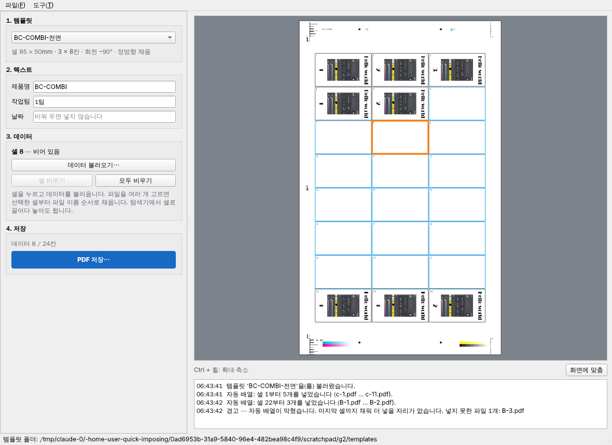
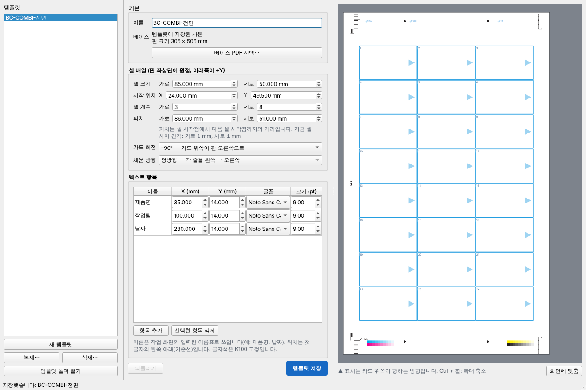
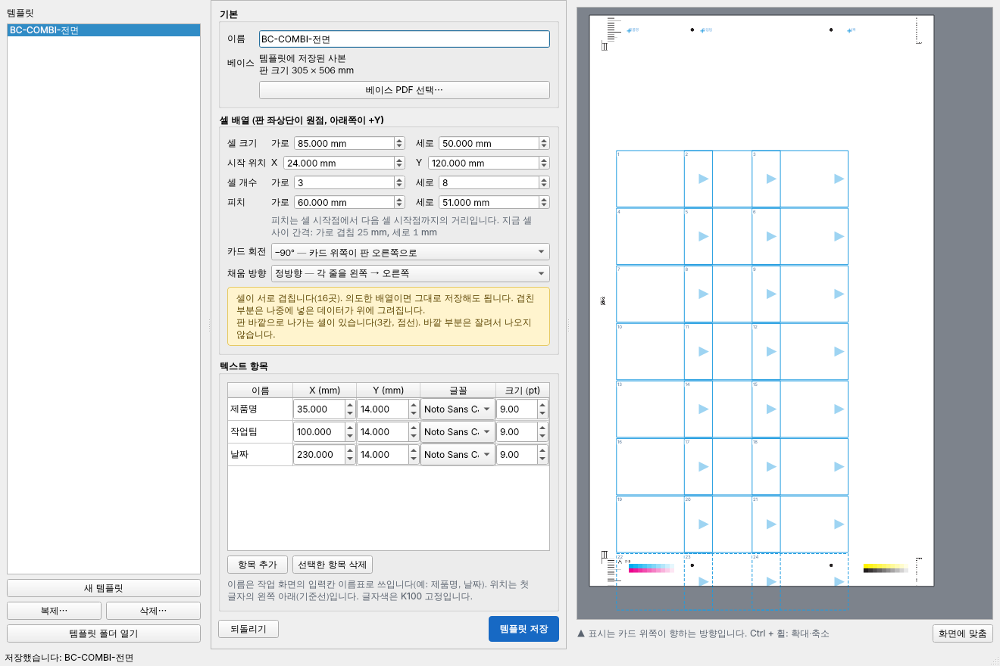

# 퀵 임포징 (quick-imposing)

명함 같은 카드 PDF를 인쇄용 판(베이스 PDF) 위의 정해진 칸에 배치해, 바로 출력할 수 있는 판 PDF를 만드는 Windows 프로그램입니다.



- **원본을 건드리지 않습니다.** 카드와 베이스의 내용(색, 레이어, 글꼴)을 그대로 옮겨 놓고, 크기는 바꾸지 않습니다. 회전과 위치 이동만 합니다.
- **판 구조는 템플릿으로 한 번만 만듭니다.** 셀 크기, 칸 수, 간격, 카드 회전, 판에 넣을 글자 자리를 템플릿에 저장해 두고 작업할 때 고르기만 합니다.
- **넣는 방법이 여러 가지입니다.** 셀마다 하나씩 넣기, 여러 파일을 이름 순서로 한 번에 채우기, 탐색기에서 끌어다 놓기, 셀 복사·붙여넣기와 연속 붙여넣기를 쓸 수 있습니다.
- **다시 열어 고칠 수 있습니다.** 저장할 때 프로젝트 파일이 함께 남아, 나중에 열어 빠진 카드를 넣거나 바꾼 뒤 다시 저장할 수 있습니다.

프로그램은 두 개입니다.

| 프로그램 | 하는 일 | 쓰는 때 |
|---|---|---|
| `QuickImposingEditor.exe` (템플릿 편집기) | 판 구조(베이스, 셀 배열, 텍스트 자리, 메모)를 템플릿으로 만든다 | 새 사양이 생겼을 때 한 번 |
| `QuickImposing.exe` (작업 프로그램) | 템플릿을 골라 셀에 카드를 넣고 PDF를 저장한다 | 매 작업 |

## 목차

- [시작하기](#시작하기)
- [1. 템플릿 만들기 (템플릿 편집기)](#1-템플릿-만들기-템플릿-편집기)
- [2. 작업하기 (작업 프로그램)](#2-작업하기-작업-프로그램)
- [저장과 덮어쓰기](#저장과-덮어쓰기)
- [셀 복사와 붙여넣기](#셀-복사와-붙여넣기)
- [다시 열어 고치기](#다시-열어-고치기)
- [화면 조작과 단축키](#화면-조작과-단축키)
- [자주 나오는 안내](#자주-나오는-안내)
- [자주 묻는 질문](#자주-묻는-질문)
- [문제 알리기](#문제-알리기)
- [라이선스](#라이선스)

## 시작하기

### 필요한 것

- Windows 10 또는 11 (64비트)
- 따로 설치할 프로그램은 없습니다. PDF 처리 도구(qpdf, Poppler)는 프로그램 폴더 안의 `bin`에 들어 있습니다.

### 설치

1. 배포 파일 `QuickImposing-<버전>.zip`의 압축을 풉니다.
2. 나온 `QuickImposing` 폴더를 원하는 곳(예: `C:\QuickImposing`)에 **통째로** 둡니다. 폴더 안의 파일을 따로 옮기지 않습니다.
3. `QuickImposing.exe`를 실행합니다. 바탕 화면에 바로 가기를 만들어 두면 편합니다.

배포 파일은 소스에서 직접 만들 수도 있습니다(저장소 README의 "개발 · 빌드").

### 새 버전으로 바꾸기

1. 두 프로그램을 모두 닫습니다.
2. 기존 `QuickImposing` 폴더를 지우거나 이름을 바꿔 둡니다.
3. 새 `QuickImposing` 폴더를 같은 자리에 둡니다.

만들어 둔 템플릿, 저장한 프로젝트와 PDF는 프로그램 폴더 밖에 있어 그대로 남습니다. 지금 쓰는 버전은 작업 프로그램의 `도구 → 프로그램 정보`에서 봅니다.

> 여러 PC에서 함께 쓰면 모든 PC를 같은 버전으로 맞춰 주세요. 예를 들어 0.6.0보다 오래된 편집기로 메모가 있는 템플릿을 저장하면 메모가 지워집니다.

### 작업 흐름 한눈에 보기

1. **템플릿 편집기**에서 베이스 PDF와 셀 배열로 템플릿을 만듭니다(처음 한 번).
2. **작업 프로그램**에서 템플릿을 고르고, 판에 넣을 글자를 입력하고, 셀에 카드 PDF를 넣습니다.
3. **PDF 저장**을 누르면 인쇄용 판 PDF와 함께 프로젝트, 미리보기, 처리 기록이 저장됩니다.

## 1. 템플릿 만들기 (템플릿 편집기)



1. **이름**을 적습니다. 예: `명함-전면`. 저장한 뒤에는 바꿀 수 없습니다.
2. **베이스 PDF 선택**을 눌러 빈 베이스(작업마다 바뀌는 글자를 지운 1페이지 PDF)를 고릅니다. 베이스는 템플릿 폴더로 복사되므로 원본을 옮기거나 지워도 됩니다.
3. 작업자에게 알려 줄 내용(용지, 재단 방향, 주의 사항 등)이 있으면 **메모**에 적습니다. 메모는 작업 프로그램에서 템플릿을 고르면 보이고, 작업 프로그램에서는 고칠 수 없습니다. PDF에는 들어가지 않습니다.
4. **셀 배열**을 입력합니다. 단위는 mm이고, 판 왼쪽 위가 (0, 0)입니다.

   | 입력 | 뜻 | 예 |
   |---|---|---|
   | 셀 크기 | 카드 한 장이 판 위에서 차지하는 크기 | 85 × 50 |
   | 시작 위치 | 첫 번째(왼쪽 위) 셀의 왼쪽 위 좌표 | X 24, Y 49.5 |
   | 셀 개수 | 가로 · 세로 칸 수 | 3 × 8 |
   | 피치 | 셀 시작점에서 다음 셀 시작점까지의 거리. 셀 크기 + 간격 | 86 × 51 (간격 1mm) |
   | 카드 회전 | 카드를 돌리는 각도. 미리보기의 삼각형이 카드 위쪽 방향 | −90° |
   | 채움 방향 | 여러 파일을 한 번에 넣을 때 각 줄을 채우는 방향 | 정방향 |

5. 판에 넣을 글자(제품명, 날짜 등)가 있으면 **항목 추가**로 자리를 만듭니다. 이름은 작업 화면의 입력칸 이름이 됩니다. 위치는 첫 글자의 왼쪽 아래(기준선) 기준입니다. 글자색은 K100입니다.
6. 오른쪽 미리보기로 위치를 확인합니다. 미리보기에서 셀을 누르면 그 셀의 좌상단 좌표와 크기가 아래에 표시되므로(예: `X110, Y20 mm 56x80mm`), 사양서의 수치와 대조할 수 있습니다.
   - **셀 하나만 위치가 어긋나 있으면** 그 셀을 누르고 아래 **셀 위치 보정** X · Y에 옮길 거리(mm)를 넣습니다. 셀 배열 위치에서 그만큼 옮겨집니다(오른쪽 +X, 아래쪽 +Y). 예: 1번 셀이 X10, Y10이고 보정 X 2, Y 3이면 실제 위치는 X12, Y13입니다.
   - 보정한 셀은 미리보기 번호 옆에 `*`가 붙고, 좌표 표시에 `(보정 X+2, Y+3)`처럼 나옵니다. `이 셀 보정 지우기`, `모든 보정 지우기`로 되돌립니다.
   - 셀 개수를 줄이면 없어진 셀의 보정은 지워집니다. 시작 위치나 피치를 바꿔도 보정은 그대로 남습니다.
7. **템플릿 저장**을 누릅니다.



- 셀이 겹치거나 판 밖으로 나가면 노란 안내가 나옵니다. 의도한 배열이면 그대로 저장해도 됩니다.
- 후면용은 전면 템플릿을 **복제**한 뒤 베이스를 후면 베이스로 바꿔 저장합니다.
- 이미 쓰는 템플릿의 셀 개수를 줄이면, 그 템플릿으로 저장했던 프로젝트가 열리지 않을 수 있습니다.
- 작업 프로그램을 켜 둔 채 템플릿을 고치면, 작업 프로그램으로 돌아왔을 때 바뀐 내용을 다시 불러옵니다.
- 셀 위치 보정을 쓴 템플릿은 0.9.0 이상에서 쓰세요. 그보다 오래된 버전은 보정을 무시하고 원래 위치에 놓습니다.

## 2. 작업하기 (작업 프로그램)

1. **템플릿**을 고릅니다. 판과 빈 셀(하늘색 선)이 보입니다. 템플릿에 메모가 있으면 템플릿 아래에 보입니다.
2. **텍스트**를 입력합니다. 비워 둔 칸은 PDF에 넣지 않습니다.
3. **데이터**(카드 PDF)를 넣습니다.
   - 셀을 누르고 `데이터 불러오기`를 누릅니다. 셀을 두 번 눌러도 됩니다.
   - 탐색기에서 PDF를 셀 위로 끌어다 놓아도 됩니다.
   - 파일을 **여러 개** 고르면, 선택한 셀부터 파일 이름 순서(1, 2, … 10, 11)로 차례로 채웁니다.
   - 이미 데이터가 있는 셀을 만나거나 마지막 셀까지 차면, 거기서 멈추고 넣지 못한 파일을 알려 줍니다.
   - 데이터가 있는 셀에 파일 하나를 넣으면 바꿀지 묻습니다.
   - 셀을 비우려면 셀을 누르고 `셀 비우기`(또는 Delete 키)를 누릅니다. 여러 셀을 선택했으면 한 번에 비웁니다.
4. **PDF 저장**을 누르고 저장 위치와 이름을 정합니다.

카드 PDF는 1페이지여야 합니다. 셀보다 큰 부분은 가려지고, 작으면 남는 부분이 비어 나옵니다. 겹치는 셀에서는 나중에 넣은 카드가 위에 그려집니다.

## 저장과 덮어쓰기

저장하면 같은 폴더에 파일 4개가 생깁니다.

| 파일 | 내용 |
|---|---|
| `이름.pdf` | 인쇄용 판 PDF |
| `이름.qiproj.json` | 프로젝트. 나중에 다시 열어 고칠 때 씁니다 |
| `이름.png` | 미리보기 그림 |
| `이름.report.json` | 처리 기록(배치 위치, 확인 결과). 문제를 알릴 때 함께 보내 주세요 |

같은 이름의 파일이 이미 있으면 무엇을 할지 묻습니다.

| 선택 | 동작 |
|---|---|
| **`이름-2`(으)로 저장** (기본) | 기존 파일은 두고 비어 있는 다음 이름으로 저장합니다 |
| **덮어쓰기** | 파일 4개를 모두 새 내용으로 바꿉니다. 저장에 실패하면 기존 파일은 그대로 남습니다 |
| **취소** | 저장하지 않습니다 |

- 덮어쓸 PDF를 Acrobat이나 Illustrator에서 열어 두었으면 바꿀 수 없다고 안내합니다. 그 프로그램에서 파일을 닫고 다시 저장하세요.
- 카드 PDF와 저장 위치는 **같은 드라이브**에 두세요. 프로젝트가 카드 파일의 위치를 저장 위치 기준으로 기억하기 때문입니다. 저장한 뒤에는 카드 파일을 옮기지 않는 것이 좋습니다.

## 셀 복사와 붙여넣기

같은 카드를 여러 칸에 반복해서 넣을 때 씁니다.

1. 복사할 셀을 선택합니다. 여러 셀은 **Ctrl+클릭**(하나씩 추가·해제)이나 **Shift+클릭**(처음 누른 셀부터 여기까지)으로 고릅니다.
2. **Ctrl+C**(또는 `편집 → 셀 복사`)를 누릅니다. 선택한 범위의 빈 셀도 빈칸으로 함께 복사됩니다.
3. 붙여넣기를 시작할 셀을 누르고 **Ctrl+V**(또는 `편집 → 셀 붙여넣기`)를 누릅니다.

- 그 셀부터 템플릿의 채움 방향 순서로 차례로 들어갑니다. 복사한 모양(행·열 위치)이 아니라 순서대로 이어 붙습니다.
- 붙여넣을 자리에 이미 데이터가 있으면 바꿀지 한 번 묻습니다. 복사한 빈칸이 놓이는 자리는 비워집니다.
- 마지막 셀까지 차면 거기서 멈추고, 넣지 못한 데이터를 알려 줍니다.
- 복사한 내용은 프로그램을 닫을 때까지 남습니다. 새 작업이나 다른 템플릿에도 붙여넣을 수 있습니다.

### 연속 붙여넣기

복사한 셀 묶음을 여러 번 이어서 넣을 때 씁니다. 같은 카드로 판을 채울 때 편합니다.

1. 위와 같이 셀을 복사합니다.
2. 시작할 셀을 누르고 **Ctrl+Shift+V**(또는 `편집 → 연속 붙여넣기`)를 누릅니다.
3. 반복 횟수를 넣고 확인을 누릅니다. 셀 3개를 복사하고 4를 넣으면 3개 묶음이 4번, 최대 12칸에 들어갑니다.

- 채움 방향 순서로 들어가며, 복사한 빈칸도 한 칸을 차지합니다.
- **기존 데이터는 바꾸지 않습니다.** 데이터가 있는 셀을 만나거나 마지막 셀까지 차면 거기서 멈춥니다. 묶음 중간이어도 들어간 데까지는 남습니다.
- 멈추면 대화상자 없이 아래 기록 창에 경고 문구가 남습니다.

## 다시 열어 고치기

`파일 → 프로젝트 열기`에서 `.qiproj.json`을 엽니다. 빠진 카드를 넣거나 바꾼 뒤 저장합니다. 같은 이름으로 저장하면 덮어쓸지 묻습니다.

카드 파일을 찾지 못한 셀은 빗금과 "파일 없음"으로 보이며, 그대로 저장하면 그 칸은 비어 나옵니다.

## 화면 조작과 단축키

| 조작 | 동작 |
|---|---|
| 셀 누르기 | 셀 선택 (주황색 테두리) |
| Ctrl+클릭, Shift+클릭 | 여러 셀 선택 (점선 테두리). 굵은 테두리가 기준 셀 |
| 셀 두 번 누르기 | 그 셀부터 데이터 불러오기 |
| Ctrl+C, Ctrl+V | 셀 복사, 붙여넣기 |
| Ctrl+Shift+V | 연속 붙여넣기(반복 횟수 입력) |
| Ctrl+A | 모든 셀 선택 |
| Delete | 선택한 셀(여러 개 포함) 비우기 |
| Ctrl+N, Ctrl+O, Ctrl+S | 새 작업, 프로젝트 열기, PDF 저장 |
| F5 | 템플릿 목록 새로 고침 |
| Ctrl + 마우스 휠 | 확대 · 축소 |
| `화면에 맞춤` | 판 전체 보기 |

## 자주 나오는 안내

| 안내 | 뜻과 할 일 |
|---|---|
| 자동 배열이 막혔습니다 | 넣을 자리가 모자랍니다. 표시된 파일은 들어가지 않았습니다. 남은 파일은 새 작업으로 넣습니다 |
| 이 템플릿은 셀이 서로 겹칩니다 | 템플릿이 겹치는 배열입니다. 겹친 곳은 나중에 넣은 카드가 위에 나옵니다 |
| 같은 이름의 파일이 있습니다 | 덮어쓸지, 다음 이름으로 저장할지 고릅니다([저장과 덮어쓰기](#저장과-덮어쓰기)) |
| 다른 프로그램에서 열려 있으면 닫고 다시 저장하세요 | 덮어쓸 파일을 다른 프로그램이 쓰고 있습니다. 닫고 다시 저장합니다. 기존 파일은 바뀌지 않았습니다 |
| 데이터와 저장 위치는 같은 드라이브에 있어야 합니다 | 카드 파일이 있는 드라이브에 저장합니다 |
| 글꼴을 찾을 수 없습니다 | 템플릿이 쓰는 글꼴이 이 PC에 없습니다. 글꼴을 설치하거나 편집기에서 글꼴을 바꿉니다 |
| 선택한 글꼴에 없는 글자가 있습니다 | 입력한 글자를 그 글꼴로 쓸 수 없습니다. 글자를 바꾸거나 편집기에서 글꼴을 바꿉니다 |
| PDF에 넣을 수 없는(임베드 금지) 글꼴입니다 / 지원하지 않는 형식의 글꼴입니다 | 편집기에서 다른 글꼴로 바꿉니다 |
| 현재 템플릿에 없는 셀을 쓰는 프로젝트입니다 | 프로젝트를 저장한 뒤 템플릿의 셀 수가 줄었습니다. 템플릿을 되돌려야 열 수 있습니다 |
| 넣을 수 없는 파일이 있습니다 | PDF가 깨졌거나 1페이지가 아닙니다. 그 파일을 빼고 다시 넣습니다 |
| 필요한 도구가 없습니다 | 프로그램 폴더의 `bin` 폴더가 없어졌습니다. 배포 파일을 다시 풀어 폴더를 통째로 둡니다 |

## 자주 묻는 질문

**템플릿은 어디에 저장되나요?**
PC 사용자마다 `%LOCALAPPDATA%\QuickImposing\templates`에 저장됩니다. `도구 → 템플릿 폴더 열기`(작업 프로그램) 또는 `템플릿 폴더 열기`(편집기)로 바로 열 수 있습니다.

**템플릿을 백업하거나 다른 PC로 옮기려면?**
템플릿 폴더 안의 템플릿 폴더(이름별 폴더)를 통째로 복사해 다른 PC의 같은 위치에 넣습니다. 폴더마다 `template.json`과 `base.pdf`가 들어 있습니다.

**카드 크기를 셀에 맞춰 줄이거나 늘려 주나요?**
아니요. 인쇄 품질을 위해 크기는 바꾸지 않고 회전과 이동만 합니다. 카드는 셀 가운데에 맞춰 놓입니다.

**재단선(톰보)을 넣어 주나요?**
아니요. 재단선이나 마크는 베이스 PDF에 미리 넣어 두세요.

**결과 PDF를 Illustrator에서 열 수 있나요?**
네. 일반 PDF로 열립니다.

**판에 넣는 글자의 색은 바꿀 수 있나요?**
지금은 K100(검정) 하나입니다.

## 문제 알리기

문제나 제안은 GitHub 저장소의 [Issues](https://github.com/steves460ng/quick-imposing/issues)에 남겨 주세요. 다음을 함께 적어 주면 원인을 찾기 쉽습니다.

- 버전(`도구 → 프로그램 정보`)
- 무엇을 했고 어떤 안내가 나왔는지
- 가능하면 그때 생긴 `이름.report.json`

카드나 베이스 PDF에 고객 정보 같은 민감한 내용이 있으면 파일을 올리지 마세요.

## 라이선스

퀵 임포징은 [MIT 라이선스](https://github.com/steves460ng/quick-imposing/blob/main/LICENSE)로 공개합니다. 누구나 자유롭게 쓰고 고치고 다시 배포할 수 있으며, 저작권 표시와 라이선스 문구만 남기면 됩니다. 프로그램은 있는 그대로 제공되며 어떤 보증도 하지 않습니다.

배포 폴더에는 함께 들어 있는 다른 프로젝트(Qt/PySide6, pikepdf, Pillow, fontTools, Python, qpdf, Poppler 등)의 라이선스가 `THIRD-PARTY-LICENSES` 폴더에 있습니다. 목록은 그 폴더의 `README.md`를 보세요. 배포 폴더를 다른 사람에게 줄 때는 `LICENSE.txt`와 `THIRD-PARTY-LICENSES` 폴더를 지우지 말고 그대로 함께 주세요.

<!-- 여기부터는 배포본의 사용설명서에 넣지 않는다 (packaging/build.ps1) -->

## 개발 · 빌드

Python 3.12 이상과 PySide6, pikepdf, fontTools를 씁니다. 소스로 실행하기, 명령행 도구(`create-template`, `build`, `autofill`), 테스트 방법은 [docs/DEVELOPMENT.md](docs/DEVELOPMENT.md)에 있습니다.

Windows 배포본(`dist\QuickImposing\`, `dist\QuickImposing-<버전>.zip`)은 PowerShell에서 다음 명령 하나로 만듭니다. qpdf · Poppler 내려받기, 빌드, 시작 점검, zip 묶기까지 합니다.

```powershell
.\packaging\build.ps1
```

| 문서 | 내용 |
|---|---|
| [docs/DEVELOPMENT.md](docs/DEVELOPMENT.md) | 소스 실행, 명령행 도구, 테스트 |
| [docs/HANDOFF-2026-11-16.md](docs/HANDOFF-2026-11-16.md) | 현재 상태, 다음에 할 일, 작업 방식 |
| [docs/HANDOFF-I18N.md](docs/HANDOFF-I18N.md) | 다국어(한국어 · 영어) 버전 검토와 진행 순서(보류) |
| [docs/HANDOFF-2026-11-13.md](docs/HANDOFF-2026-11-13.md) | 빌드 · 배포 절차와 문제 해결 |
| [docs/SPEC.md](docs/SPEC.md), [docs/TEMPLATE-REQUIREMENTS.md](docs/TEMPLATE-REQUIREMENTS.md) | 배치 규칙과 요구사항 |
| [docs/UI-DESIGN.md](docs/UI-DESIGN.md) | 화면 구성과 결정 근거 |
| [docs/REFACTORING.md](docs/REFACTORING.md) | 리팩토링 제안과 진행 상황 |
| [GitHub Pull Requests](https://github.com/steves460ng/quick-imposing/pulls?q=is%3Apr) | 변경 기록(구현 · 결정 · 검증). 2026-11-17 이전의 `PR/` 문서 기록은 커밋 `8dd39b7`에 있다 |

### 라이선스와 서드파티 고지

- 소스 코드: [MIT](LICENSE) (Copyright (c) 2026 steves460ng)
- 배포본: `build.ps1`이 `LICENSE.txt`와 `THIRD-PARTY-LICENSES\`를 넣습니다. [packaging/collect_licenses.py](packaging/collect_licenses.py)가 빌드에 쓴 Python 패키지(실행에 필요한 의존성 전체와 PyInstaller), Python, qpdf, Poppler의 라이선스 문서와 버전 표(`README.md`)를 모읍니다. 패키지에 라이선스 문서가 없으면(Qt/PySide6) [packaging/licenses/](packaging/licenses)의 표준 문서를 넣습니다. 그래도 문서가 없는 구성 요소는 경고만 하고 빌드를 계속하며, 표에 "라이선스 문서 없음"과 원문 주소를 적습니다. 밖으로 배포하기 전에는 `.\packaging\build.ps1 -StrictLicenses`로 빌드하면 그런 구성 요소가 있을 때 빌드를 멈춥니다.
- 함께 배포하는 [qpdf](https://github.com/qpdf/qpdf)는 Apache License 2.0, [Poppler](https://poppler.freedesktop.org/)는 GPL, Qt/PySide6는 LGPL-3.0입니다. 배포본을 다시 배포할 때는 이 조건을 따라야 합니다(Poppler 소스 제공 안내는 `THIRD-PARTY-LICENSES\README.md`).
