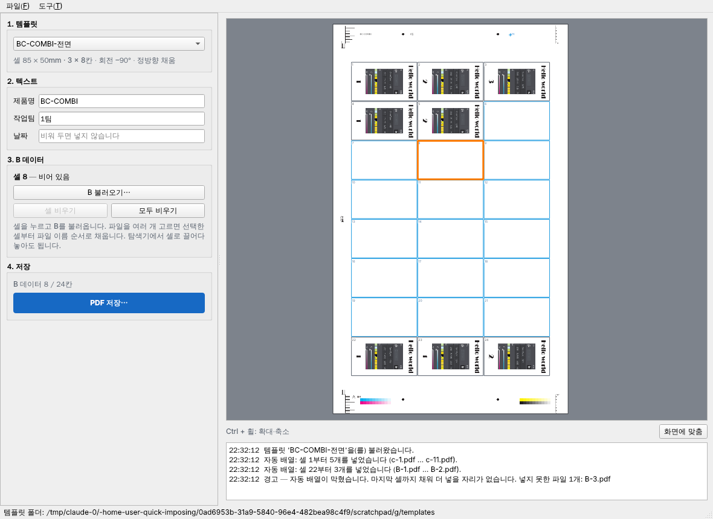
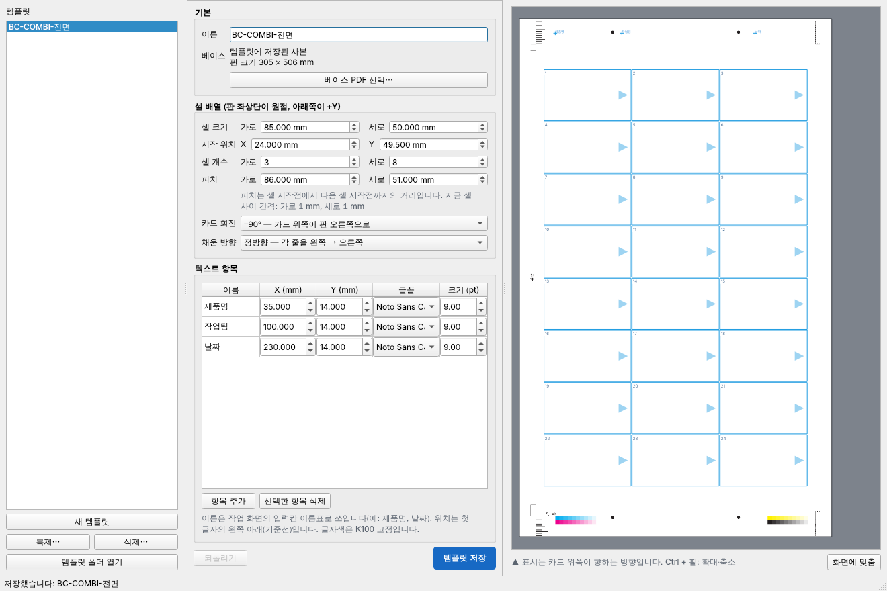
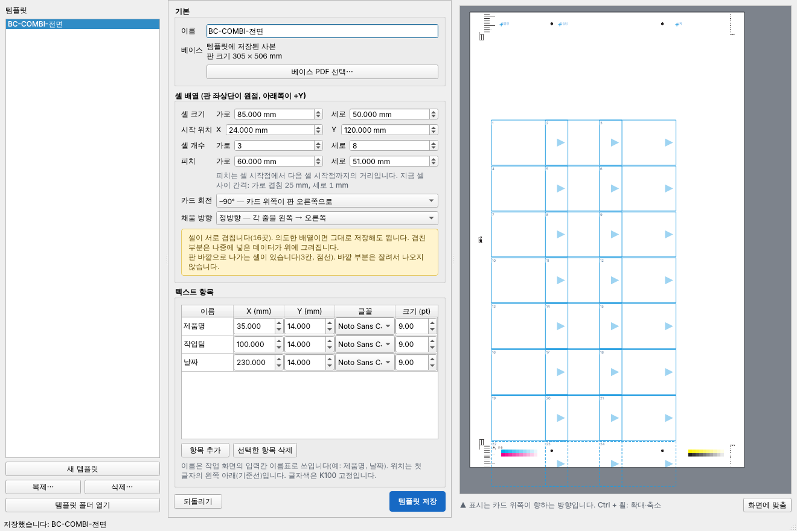

# GUI 구성과 배포 결정

| 항목 | 내용 |
|---|---|
| 문서 버전 | v0.1 |
| 작성일 | 2026-11-12 |
| 상태 | **검토 대기**. 사용자 인터뷰 없이 검토자가 임의 판단으로 정했다(사용자 위임, 2026-11-12). 사용자 확인 후 확정한다 |
| 관련 문서 | `docs/TEMPLATE-REQUIREMENTS.md` v0.3 (요구사항), `docs/SPEC.md` v0.6 (배치 규칙), `docs/USER-GUIDE.md` (사용설명서), `PR/004-gui.md` (구현·검증 기록) |

`docs/HANDOFF-2026-11-11.md`의 미결 1·2·3·6·7에 대한 결정과 근거를 적는다. 요구사항 문서에 이미 확정된 규칙은 바꾸지 않았다.

---

## 1. 결정 요약

| 미결 | 결정 | 근거 |
|---|---|---|
| 1. UI 구성 | 프로그램 두 개. 작업 프로그램은 왼쪽에 1 템플릿 → 2 텍스트 → 3 B 데이터 → 4 저장 순서의 패널, 오른쪽에 판 미리보기. 템플릿 편집기는 목록 · 입력 폼 · 실시간 미리보기 3단 | 요구사항 §6.2의 작업 흐름 순서를 화면 순서로 그대로 옮겼다. 그래픽 툴 경험이 없어도 위에서 아래로 따라가면 된다 |
| 2. 텍스트 입력칸 이름표 | 보여준다. 템플릿 텍스트 항목의 `id`를 이름표로 쓴다(예: `제품명`). 별도 `label` 키는 만들지 않는다 | 입력칸이 여러 개면 이름표 없이는 구분할 수 없다. `id`에 한글을 쓸 수 있어 형식(`template@2`)을 바꾸지 않아도 된다 |
| 3. 겹침 경고 위치 | 편집기: 값을 바꾸는 즉시 폼 안에 노란 안내(저장은 막지 않음). 작업 프로그램: 템플릿을 불러올 때 미리보기 위에 안내 한 줄을 계속 표시. 저장할 때 다시 묻지 않는다 | "경고 후 진행" 규칙을 지키되, 의도한 겹침 배열을 쓰는 작업자를 매번 대화상자로 막지 않는다 |
| 6. Windows 검증 | GitHub Actions `windows-latest`에서 pytest · 3-1차 · 3-2차 실행기 · 맑은 고딕 · 한글 경로 · 배포본 시작 점검을 돌린다(`.github/workflows/windows.yml`) | 검증 환경이 Linux뿐이었다. 사람 손 없이 반복할 수 있는 Windows 검증이 필요하다. 실제 PC에서의 확인은 `docs/CLI-TEST-GUIDE.md`와 사용설명서로 한다 |
| 7. 배포 형태 | 설치 프로그램 없이 **압축을 푸는 폴더 하나**. Python 런타임, qpdf, Poppler를 폴더에 포함한다. 템플릿 폴더는 `%LOCALAPPDATA%\QuickImposing\templates`이며 첫 실행 때 만든다 | 작업 PC에 Python이나 PATH 설정을 요구하지 않는다. 템플릿은 "설치할 때 만들어지는 별도 폴더, 공유하지 않음"(요구사항 §4)에 맞춰 사용자별 폴더에 둔다 |
| GUI 기술 | Python + PySide6(Qt 6) | 배치 엔진을 그대로 호출한다. 파일 끌어다 놓기, 확대·축소 미리보기, 한글 입력이 기본 제공된다 |

## 2. 작업 프로그램 (`QuickImposing.exe`)



| 영역 | 동작 |
|---|---|
| 1. 템플릿 | 이름 목록에서 고른다(탐색기와 같은 숫자 정렬). 고르면 셀 크기 · 칸 수 · 회전 · 채움 방향을 한 줄로 보여준다 |
| 2. 텍스트 | 템플릿의 텍스트 항목마다 이름표와 입력칸. 비워 두면 넣지 않는다. 입력하는 대로 미리보기에 실제 글꼴 · 크기 · 위치로 보인다. 빈 항목은 하늘색 십자와 이름으로 자리를 표시한다 |
| 3. B 데이터 | 미리보기에서 셀을 누르고 `B 불러오기`. 셀을 두 번 눌러도 된다. 탐색기에서 셀로 끌어다 놓을 수 있다 |
| 4. 저장 | `PDF 저장`. 저장 위치를 고르면 PDF · 프로젝트 · 미리보기 · 리포트 4개가 함께 저장된다 |
| 미리보기 | 베이스, 빈 셀(하늘색 선), 셀 번호, 넣은 B(회전 · 클리핑 반영, 넣은 순서대로 겹침), 선택한 셀(주황색) |
| 알림 | 아래쪽 기록 칸에 시각과 함께 남긴다. 자동 배열 막힘과 오류는 대화상자로도 알린다 |

**B 넣기 규칙** (요구사항 §6.3 · §6.4 그대로)

| 상황 | 동작 |
|---|---|
| 빈 셀에 파일 1개 | 그 셀에 넣는다. 넣은 순서는 맨 뒤 |
| 데이터가 있는 셀에 파일 1개 | 바꿀지 묻고, 바꾸면 **겹침 순서는 원래대로** 유지한다 |
| 파일 여러 개 | 선택한 셀부터 파일 이름 숫자 정렬 순서로 자동 배열. 막히면 그 앞까지 넣고, 넣지 못한 파일 이름을 경고로 보여준다 |
| 열 수 없는 PDF, 1페이지가 아닌 PDF가 섞임 | 아무것도 넣지 않고 어떤 파일이 왜 안 되는지 알린다 |
| `셀 비우기` 후 다시 넣기 | 새로 넣은 것으로 보고 넣은 순서는 맨 뒤가 된다 |

**저장 규칙**

- 기존 결정대로 같은 이름의 결과 파일 4개 중 하나라도 있으면 덮어쓰지 않는다. 이때 `이름-2.pdf`처럼 비어 있는 다음 이름을 제안한다.
- 오류로 PDF를 만들지 못하면 한국어 사유를 보여주고 폴더에 아무 파일도 남기지 않는다. 원인을 고친 뒤 같은 이름으로 다시 저장할 수 있다.
- B 데이터와 저장 위치는 같은 드라이브여야 한다(프로젝트가 B를 상대경로로 참조하기 때문).

**다시 열기**: `파일 → 프로젝트 열기`로 `.qiproj.json`을 연다. 현재 저장된 템플릿 기준으로 열며, 없는 셀을 쓰는 프로젝트는 오류로 안내하고 열지 않는다. B 파일이 없으면 안내 없이 열고, 그 셀은 빗금과 "파일 없음"으로 표시한다(배정은 유지).

작업 중 편집기에서 템플릿을 고치면, 작업 프로그램 창으로 돌아올 때 새 템플릿으로 다시 읽는다.

## 3. 템플릿 편집기 (`QuickImposingEditor.exe`)



| 영역 | 동작 |
|---|---|
| 목록 | 템플릿 이름 목록, `새 템플릿`, `복제`, `삭제`, `템플릿 폴더 열기` |
| 기본 | 이름, 베이스 PDF 선택(판 크기 표시). 저장한 뒤에는 이름을 바꿀 수 없다(프로젝트가 이름으로 템플릿을 찾기 때문). 다른 이름이 필요하면 복제한다 |
| 셀 배열 | 셀 크기, 시작 위치, 셀 개수, 피치(mm). 피치와 셀 크기의 차이를 "셀 사이 간격"으로 바로 계산해 보여준다. 카드 회전, 채움 방향 |
| 텍스트 항목 | 표에서 이름 · X · Y · 글꼴 · 크기를 편집. 글꼴 목록에는 이 PC에 설치되어 있고 PDF에 넣을 수 있는 글꼴만 나온다 |
| 미리보기 | 값을 바꾸는 대로 셀 배열과 텍스트 위치를 다시 그린다. 각 셀의 삼각형은 카드 위쪽이 향하는 방향이다. 판 바깥으로 나가는 셀은 점선 |

- 전면 · 후면 템플릿은 `복제`한 뒤 베이스만 바꿔 만든다.
- 이미 쓰고 있는 템플릿의 셀 개수를 바꿔 저장하면, 기존 프로젝트가 열리지 않을 수 있다고 한 번 확인한다(요구사항 §6.5: 수정한 사람의 책임).
- 삭제는 확인을 거친 뒤 템플릿 폴더와 베이스 사본을 지운다.



## 4. 배포 구성

```
QuickImposing\
├─ QuickImposing.exe          작업 프로그램
├─ QuickImposingEditor.exe    템플릿 편집기
├─ _internal\                 Python 런타임과 라이브러리
├─ bin\qpdf\, bin\poppler\    PDF 검사 · 미리보기 도구
└─ 사용설명서.md
```

- 빌드: `pyinstaller packaging/quick-imposing.spec`. Windows 빌드는 GitHub Actions `windows` 워크플로가 만들고 `QuickImposing-windows` 아티팩트로 올린다.
- 템플릿 폴더는 환경 변수 `QUICK_IMPOSING_TEMPLATES`로 바꿀 수 있다(테스트 · 특수 배치용).
- 프로그램은 시작할 때 `bin\` 폴더를 먼저 찾으므로 PC에 qpdf · Poppler를 따로 설치하지 않아도 된다.

## 5. 엔진에 더한 변경

배치 결과(PDF 바이트, 행렬, BBox)에 영향을 주는 변경은 없다. 3-1차 · 3-2차 실행기와 기존 pytest로 회귀를 확인했다.

| 변경 | 이유 |
|---|---|
| `autofill.plan_fill` 분리 | 명령행 자동 배열과 작업 프로그램이 같은 채움 · 막힘 로직을 쓰게 했다 |
| 외부 도구 실행 시 콘솔 창 숨김(`CREATE_NO_WINDOW`) | 창 프로그램에서 qpdf · pdftoppm을 부를 때마다 검은 창이 깜빡이는 것을 막는다 |
| `qpdf --check`와 미리보기 렌더링을 임시 폴더 안에서 파일 이름만으로 실행 | 한글 저장 경로가 도구의 명령행에 들어가지 않게 한다 |
| `imposing/store.py`, `imposing/session.py` 추가 | 템플릿 폴더 관리(생성 · 수정 · 복제 · 삭제)와 작업 중 편집 상태. 화면 없이 테스트할 수 있게 GUI와 분리했다 |

## 6. 확인이 필요한 항목

임의 판단으로 정했으므로 사용자가 보고 바꿀 수 있는 항목이다.

| # | 항목 | 지금 처리 | 대안 |
|---|---|---|---|
| 1 | 같은 이름으로 다시 저장 | 덮어쓰지 않고 `이름-2` 제안 (기존 결정 유지) | 누락 수정처럼 다시 저장이 잦으면, 확인 후 4개 파일을 함께 교체하는 방식 |
| 2 | 템플릿 폴더 위치 | `%LOCALAPPDATA%\QuickImposing\templates` | 문서 폴더나 프로그램 폴더 옆 `templates\` (백업 · PC 교체가 쉬움) |
| 3 | 없는 B 파일 표시 | 대화상자 없이 셀에 빗금과 "파일 없음" | 표시 자체를 없애 완전한 빈칸으로 |
| 4 | 설치 방식 | 압축 해제형 폴더 | 설치 프로그램(시작 메뉴 등록, `.qiproj.json` 연결) |
| 5 | Poppler 포함 배포 | 폴더에 실행 파일 포함 | Poppler는 GPL이다. 사내 사용은 문제없지만, 외부에 배포하려면 라이선스 고지와 소스 제공 조건을 확인해야 한다 |
| 6 | 사람 확인(V18) | Illustrator로 여는 확인은 하지 못했다. GUI는 3-1차 · 3-2차에서 확인한 것과 같은 엔진 경로로 PDF를 만든다 | 배포본으로 만든 PDF 한 장을 Illustrator에서 열어 확인 |
